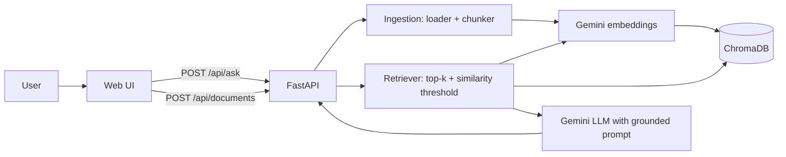

# PlacementPrep AI

A Retrieval-Augmented Generation (RAG) assistant that answers placement-preparation questions from your own documents: interview experiences, company notes, DSA guides. Every answer cites the exact passages it was built from, and the assistant says so when the knowledge base doesn't contain the answer instead of guessing.

**Live demo:** `<add your Render URL>`  |  **Screenshots:** `<add 2 screenshots to /docs and link them here>`

## Features
- Upload PDF, TXT or Markdown files; they are parsed, chunked, embedded and indexed automatically
- Grounded answers with numbered citations `[1] [2]` and expandable source snippets (file, page, match score)
- Refuses to answer when retrieval finds nothing relevant, and skips the LLM call entirely in that case
- Prompt-injection hardening: retrieved text is treated as data, never as instructions
- Admin-key protection on upload and delete for public deployments
- Bundled sample documents that auto-load on startup, so a fresh deploy is never empty
- Evaluation script (retrieval hit rate, keyword recall, refusal accuracy) and automated tests
- Dockerised, with a one-file deploy config for Render

## Architecture


**Query flow:** question -> query embedding -> top-k cosine search in ChromaDB -> drop chunks below the similarity threshold -> build a prompt with numbered passages -> LLM answers with citations -> API returns answer and sources.

## Tech stack
Python 3.11, FastAPI, ChromaDB (persistent vector store, cosine similarity), Google Gemini API (embeddings and generation), pypdf, vanilla HTML/CSS/JS frontend, Docker, pytest.

## Project structure
```
app/
  main.py          FastAPI routes, auth dependency, startup ingestion
  rag.py           ingest / retrieve / answer pipeline
  chunking.py      recursive chunker with overlap
  loaders.py       PDF / TXT / MD parsing
  embeddings.py    Gemini embeddings with batching and retry
  llm.py           grounded prompt and generation
  vectorstore.py   ChromaDB wrapper
  config.py        environment-based settings
static/index.html  chat UI
knowledge_base/    documents auto-indexed on startup
eval/              evaluation set and runner
tests/             unit and API tests (AI calls mocked)
```

## Run locally
```bash
git clone <your-repo-url> && cd placementprep-rag
python -m venv .venv && source .venv/bin/activate      # Windows: .venv\Scripts\activate
pip install -r requirements.txt
cp .env.example .env                                   # then paste your GEMINI_API_KEY
uvicorn app.main:app --reload
```
Open http://localhost:8000. Get a free API key from https://aistudio.google.com/apikey.

### Run with Docker
```bash
docker build -t placementprep-rag .
docker run -p 8000:8000 --env-file .env placementprep-rag
```

## Configuration
| Variable | Default | Purpose |
|---|---|---|
| `GEMINI_API_KEY` | none | Required for embeddings and answers |
| `LLM_MODEL` | `gemini-2.5-flash` | Generation model (check Google's docs for current names) |
| `EMBEDDING_MODEL` | `gemini-embedding-001` | Embedding model |
| `EMBEDDING_DIM` | `768` | Embedding size (smaller = less storage) |
| `ADMIN_KEY` | empty | If set, required as `X-Admin-Key` for upload and delete |
| `CHUNK_SIZE` / `CHUNK_OVERLAP` | `800` / `120` | Chunking in characters |
| `TOP_K` | `5` | Passages retrieved per question |
| `MIN_SIMILARITY` | `0.30` | Below this, a passage is ignored |

## API
| Method | Path | Description |
|---|---|---|
| GET | `/api/health` | Status and document count |
| GET | `/api/documents` | List indexed documents |
| POST | `/api/documents` | Upload a file (multipart, admin key if configured) |
| DELETE | `/api/documents/{name}` | Remove a document |
| POST | `/api/ask` | `{"question": "...", "top_k": 5}` -> `{answer, sources[]}` |

Interactive docs are available at `/docs`.

## Deploy to Render (free tier)
1. Push this repository to GitHub (make sure `.env` is **not** committed).
2. On https://render.com choose **New -> Blueprint**, select your repo, and Render reads `render.yaml`.
3. When prompted, set `GEMINI_API_KEY`. Render generates an `ADMIN_KEY` for you; copy it from the service's Environment tab.
4. Wait for the build, then open the `.onrender.com` URL. Check `/api/health`.
5. Add the live URL to this README and to your resume.

Notes for free hosting:
- The disk is ephemeral, so uploaded documents are lost on redeploy or restart. Documents in `knowledge_base/` are re-indexed automatically on every start, so commit the important ones there.
- Free services sleep after inactivity, so the first request can take about a minute. Open the link before an interview.
- Alternative: Hugging Face Spaces (Docker SDK). Set `PORT=7860` and add the key under Space secrets.

## Evaluation
```bash
python -m eval.run_eval
```
Reports retrieval hit rate@k, keyword recall in answers, refusal accuracy on out-of-scope questions, and average latency. The bundled `eval/eval_set.json` is a starter; expand it to 30-50 questions drawn from your real documents, run it, and record your numbers here:

| Metric | Result |
|---|---|
| Retrieval hit rate@5 | `<your result>` |
| Keyword recall | `<your result>` |
| Refusal accuracy | `<your result>` |

Run the unit and API tests with `pytest`.

## Design decisions
- **Hosted embeddings and LLM** keep the container small enough for free hosting; a local model would need far more RAM.
- **Custom chunker** (paragraph -> sentence -> word boundaries, with overlap) so I control the retrieval unit and can test it, instead of hiding it inside a framework.
- **Similarity threshold before generation** reduces hallucination and saves API calls on out-of-scope questions.
- **Citations by design**: passages are numbered in the prompt and the model must cite them, so every claim can be verified.
- **Output rendered as text nodes** in the UI, so model output cannot inject HTML.

## Limitations and future work
- Dense retrieval only; adding BM25 hybrid search and a reranker would improve exact-term queries
- No conversation memory; each question is answered independently
- Scanned PDFs without a text layer need OCR
- Persistent storage (a managed vector DB or a mounted disk) for production use
- Per-IP rate limiting on `/api/ask`
